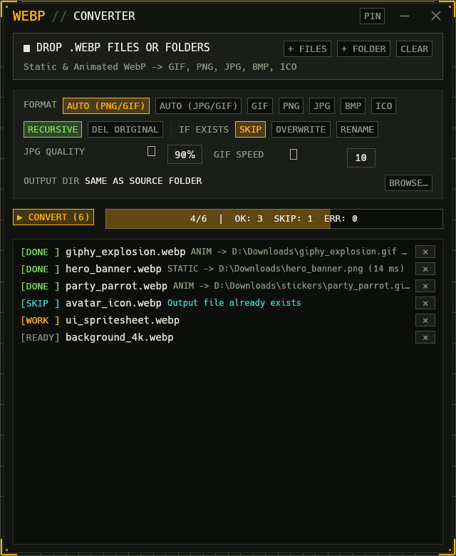
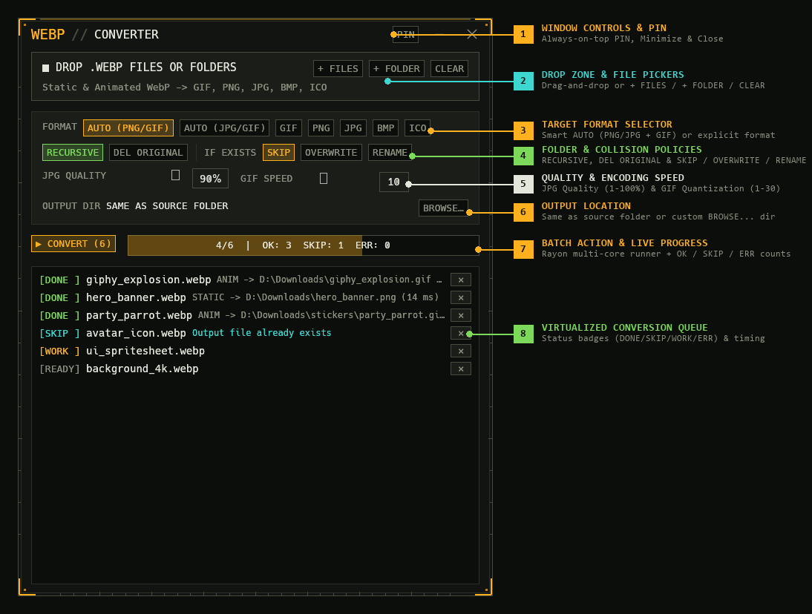

# WEBP // Converter

A fast, standalone, pure-Rust desktop GUI and command-line utility for converting **static and animated `.webp`** files—either individually or across entire directory trees—into **`.gif`**, **`.png`**, **`.jpg`**, **`.bmp`**, or **`.ico`**, built with [`egui`](https://github.com/emilk/egui) / [`eframe`](https://github.com/emilk/egui/tree/master/crates/eframe).

It automatically inspects every `.webp` file's RIFF/VP8X header to detect whether it is static or animated, routes it to the appropriate encoder in **Auto Mode** (e.g. Static → `PNG` or `JPG`, Animated → multi-frame `GIF`), and processes folders in parallel across all CPU cores using [`rayon`](https://crates.io/crates/rayon).

<p align="center">
  
</p>

---

## Interface & Control Reference

<p align="center">
  
</p>

### 1. Window Controls & Pin (`PIN`)
Custom frameless HUD title bar with window controls:
- **`PIN`**: Toggles Always-on-Top window level so you can drag and drop files from Explorer without the converter window losing visibility.
- **`—` / `✕`**: Minimize or close the application window. Drag anywhere on the empty title bar to move the window.

### 2. Drop Zone & File Pickers (`■ DROP .WEBP FILES OR FOLDERS`)
Add individual `.webp` images or entire folder hierarchies to the conversion queue:
- **Drag and Drop**: Drag any combination of `.webp` files and folders directly from Windows Explorer onto the window. The card border glows amber while hovering files.
- **`+ FILES`**: Opens a native file dialog filtered to `.webp` images.
- **`+ FOLDER`**: Opens a native folder picker and scans for `.webp` files inside the selected directory.
- **`CLEAR`**: Empties the current conversion queue.

### 3. Target Format Selector (`FORMAT`)
Controls how static and animated `.webp` inputs are encoded:
- **`AUTO (PNG/GIF)`** *(Default)*: Converts static `.webp` files to lossless **`.png`** and animated `.webp` files to looping **`.gif`**.
- **`AUTO (JPG/GIF)`**: Converts static `.webp` files to **`.jpg`** (compositing transparency onto a clean white background) and animated `.webp` files to **`.gif`**.
- **`GIF`**: Encodes both static and animated `.webp` files as `.gif` (preserving frame delays and infinite loop repeat for animations).
- **`PNG` / `JPG` / `BMP` / `ICO`**: Explicitly converts inputs to the chosen static image format.
  - When an explicit static format is selected, an **`ANIMATED -> STATIC`** row appears with two modes:
    - **`FIRST FRAME`**: Saves only the first frame (`<name>.<ext>`).
    - **`ALL FRAMES`**: Extracts every frame in the animation as `<name>_0001.<ext>`, `<name>_0002.<ext>`, etc.
  - When **`ICO`** is selected, images larger than `256×256` are automatically downscaled proportionally with a `Lanczos3` filter to meet the ICO specification.

### 4. Folder & Collision Policies (`RECURSIVE`, `DEL ORIGINAL`, `IF EXISTS`)
Controls how folders and existing output files are handled:
- **`RECURSIVE`** *(Green when active)*: Scans all nested subdirectories when a folder is added or dropped. When disabled, only top-level `.webp` files in the folder are queued.
- **`DEL ORIGINAL`** *(Red when active)*: Deletes the source `.webp` file **only after** all output files for that source have been flushed and atomically renamed without error. Corrupt or skipped files never delete their source.
- **`IF EXISTS`**:
  - **`SKIP`**: Leaves existing output files untouched and marks the item as `[SKIP ]`.
  - **`OVERWRITE`**: Atomically replaces existing output files via a temporary `.webp-tmp` file.
  - **`RENAME`**: Appends an incrementing counter (`photo (1).png`, `photo (2).png`, …) so existing files are never overwritten.

### 5. Quality & Encoding Speed (`JPG QUALITY` & `GIF SPEED`)
Fine-tunes encoder compression and speed (persisted across restarts):
- **`JPG QUALITY` (`1%–100%`, default `90%`)**: Controls JPEG compression quality when outputting `.jpg` files.
- **`GIF SPEED` (`1–30`, default `10`)**: Controls GIF color quantization speed (`1` = highest palette quality / slowest, `30` = fastest quantization).

### 6. Output Location (`OUTPUT DIR`)
- **`SAME AS SOURCE FOLDER`** *(Default)*: Saves each converted file directly alongside its original `.webp` file.
- **`BROWSE...`**: Choose a dedicated output root directory. When converting folders recursively, relative subdirectory trees are automatically preserved inside the custom output directory. Click **`SAME AS SOURCE`** to reset.

### 7. Batch Action & Live Progress Bar (`▶ CONVERT` / `■ CANCEL BATCH`)
- **`▶ CONVERT (N)`**: Launches the multi-threaded `rayon` worker pool across all queued items. Changes to **`■ CANCEL BATCH`** while a batch is active so you can stop gracefully at any point without leaving half-written files behind.
- **Progress Readout (`4/6 | OK: 3 SKIP: 1 ERR: 0`)**: Real-time progress bar and counters for converted (`OK`), skipped (`SKIP`), and failed (`ERR`) items.

### 8. Virtualized Conversion Queue
High-FPS virtualized scroll list capable of rendering thousands of queued files smoothly:
- **Status Badges**:
  - **`[READY]`** *(Muted)*: Queued and waiting to run.
  - **`[WORK ]`** *(Amber)*: Currently being decoded/encoded on a worker thread.
  - **`[DONE ]`** *(Green)*: Completed, showing detected type (`ANIM` or `STATIC`), output path, and elapsed time in milliseconds.
  - **`[SKIP ]`** *(Cyan)*: Skipped due to existing output file policy.
  - **`[ ERR ]`** *(Red)*: Failed to decode/write, displaying the exact error reason inline.
- **`×` Button**: Removes an individual file from the queue when idle.

---

## Command-Line Interface (CLI)

The same binary doubles as a scriptable command-line tool whenever arguments are passed:

```powershell
# Auto-convert an entire folder tree (Static -> PNG, Animated -> GIF)
webp-converter D:\Photos\WebP

# Convert a folder to a dedicated output directory, preserving subfolder structure
webp-converter D:\Photos\WebP --format auto-jpg --output D:\Photos\Converted

# Force animated WebPs to extract all frames as PNGs, renaming on collision
webp-converter .\stickers --format png --animated-policy all-frames --existing rename
```

### CLI Options

| Flag / Option | Default | Description |
| :--- | :--- | :--- |
| `<INPUTS>...` | *(Required)* | One or more `.webp` files or directories to convert |
| `-f, --format <FORMAT>` | `auto-png` | `auto-png`, `auto-jpg`, `gif`, `png`, `jpg`, `bmp`, `ico` |
| `-o, --output <DIR>` | *(In-place)* | Custom output directory (preserves relative subfolder paths) |
| `--no-recursive` | `false` | Disable recursive subdirectory scanning |
| `--animated-policy <POLICY>` | `first-frame` | `first-frame` or `all-frames` when converting animated WebP to a static format |
| `--existing <POLICY>` | `skip` | `skip`, `overwrite`, or `rename` when output file exists |
| `--delete-original` | `false` | Delete original `.webp` file after verified conversion |
| `--jpg-quality <1-100>` | `90` | JPEG encoding quality (`1–100`) |
| `--gif-speed <1-30>` | `10` | GIF quantization speed (`1` = best quality, `30` = fastest) |
| `-j, --jobs <N>` | *(All cores)* | Override number of parallel `rayon` worker threads |

---

## Features

- **100% Safe, Pure Rust (`#![forbid(unsafe_code)]`)**:
  - Zero C/C++ build dependencies (`cmake`/`nasm` not required); compiles cleanly into a single portable `.exe`.
- **Smart Animated & Static Detection**:
  - Inspects WebP headers via `image::codecs::webp::WebPDecoder::has_animation()` and preserves frame timings (with `<10ms` zero-delay frame normalization to `100ms` so animations play at intended speed).
- **Atomic File Writes & Crash Safety**:
  - Encodes every output to an isolated `.webp-tmp` file first and atomically renames on completion—cancelling mid-batch or hitting a corrupt input file never leaves half-written images behind.
- **Persistent Desktop Settings**:
  - Remembers your chosen format, policies, quality sliders, custom output folder, and window position across restarts.

---

## Getting Started

### Prerequisites

- [Rust](https://rustup.rs/) `1.90` or newer (Rust 2024 edition)

### Build & Run

```powershell
# Launch the desktop GUI in development mode
cargo run

# Build optimized release binary
cargo build --release
```

The compiled release executable will be located at:

```text
target/release/webp-converter.exe
```

### Run Tests

```powershell
cargo test
```
